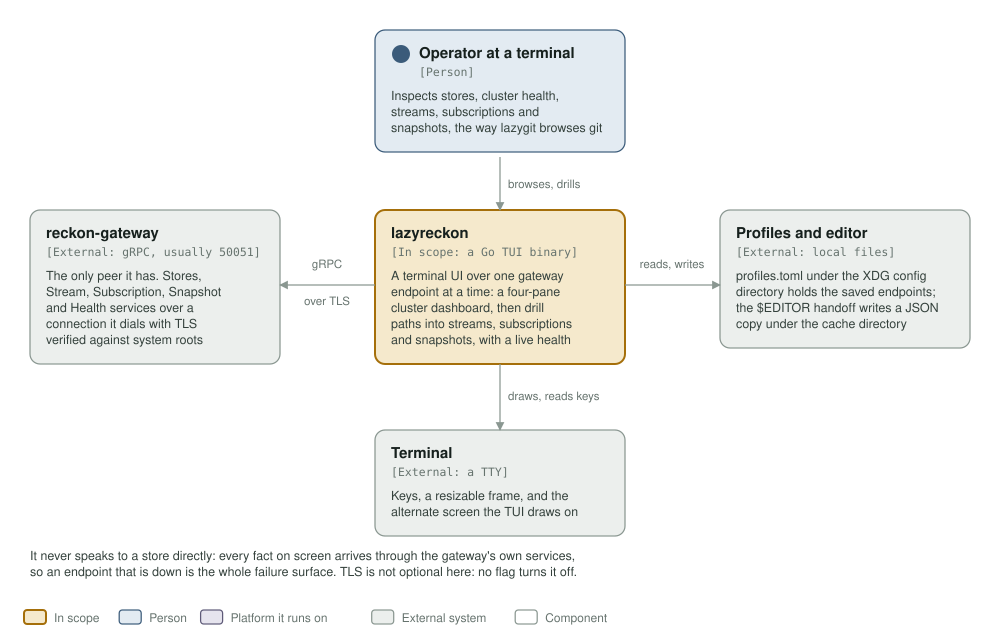
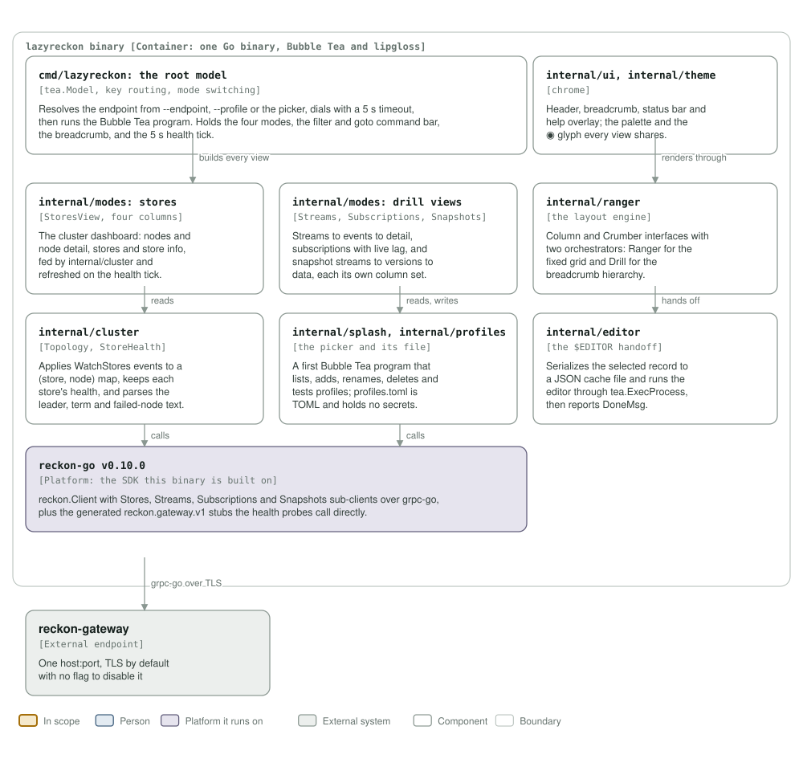

# lazyreckon architecture

A C4 model of the TUI, drawn from the packages in this repository rather than
from a template. `c4_diagrams.py` generates both diagrams; run it after a change
that adds, removes or renames a package:

```
python3 architecture/c4_diagrams.py
rsvg-convert -w 1400 assets/c4-context.svg -o /tmp/c4-context.png   # look at it
```

The `c4 model` workflow fails a commit that drops either file or its link here,
and a diagram that still names a package the binary lost is drift.

## Level 1: system context



| Element | What it is | Why it is there |
|---|---|---|
| **lazyreckon** | One Go binary (`cmd/lazyreckon`), a Bubble Tea terminal UI | The system this repository builds |
| Operator at a terminal | Person | Inspects stores, cluster health, streams, subscriptions and snapshots |
| reckon-gateway | External system | Its only peer: the Stores, Stream, Subscription, Snapshot and Health services, over one `host:port` |
| Profiles and editor | External, local files | `profiles.toml` under the XDG config directory; the `$EDITOR` handoff's JSON copy under the cache directory |
| Terminal | External | Keys, a resizable frame, and the alternate screen |

It never speaks to a store directly: every fact on screen arrives through the
gateway's own services, so an endpoint that is down is the whole failure surface.
TLS is not optional — `reckon-go` verifies against the system roots and this
binary passes no dial option that would change that.

## Level 3: components



| Component | Real packages | Responsibility |
|---|---|---|
| Root model | `cmd/lazyreckon` | Resolves the endpoint (`--endpoint`, `--profile`, or the picker), dials with a 5 s timeout, then runs the program: the four modes, the filter and goto command bar, the breadcrumb, the health tick |
| Chrome | `internal/ui`, `internal/theme` | Header, breadcrumb, status bar, help overlay, palette, glyph |
| The dashboard | `internal/modes` (`StoresView`), `internal/cluster` | Four panes of topology and health, fed by `WatchStores` events applied to a (store, node) map |
| Drill views | `internal/modes` (`StreamsView`, `SubscriptionsView`, `SnapshotsView`) | Streams to events to detail, subscriptions with live lag, snapshot streams to versions to data |
| Layout engine | `internal/ranger` | `Column` and `Crumber` interfaces; `Ranger` for the fixed grid, `Drill` for the breadcrumb hierarchy |
| Picker and profiles | `internal/splash`, `internal/profiles` | A first program that lists, adds, renames, deletes and tests profiles, and the TOML file behind it |
| Editor handoff | `internal/editor` | Writes the selected record to a JSON cache file and runs the editor through `tea.ExecProcess` |
| reckon-go v0.10.0 | external module | `reckon.Client` and its sub-clients over grpc-go, plus the generated stubs the health probes call directly |

## What this model does not say

- **The gateway's own inside.** `reckon-gateway` and the clusters behind it are
  other repositories; this diagram stops at the endpoint.
- **The developer tools.** `cmd/btrepro`, `cmd/viewinspect` and the `e2e` suite
  (build tag `e2e`, needs a live gateway) are not part of the shipped binary.
- **Auth.** There is no token or client certificate: `plans/DESIGN_CONNECTION_AUTH.md`
  is a draft, and the transport is the only boundary there is.
